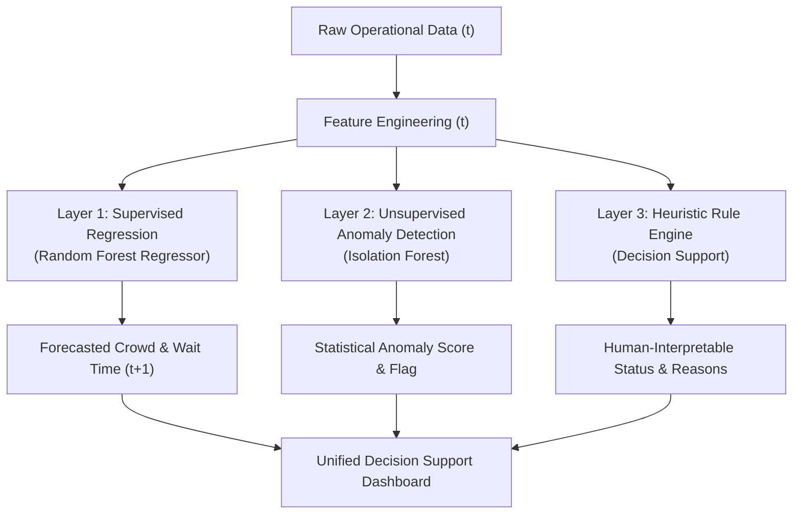

# Connected Healthcare — Algorithm Explanation & Methodological Reference

This document provides a clear, beginner-friendly yet technically sound explanation of the algorithms, feature engineering techniques, and evaluation methodologies implemented in the Connected Healthcare system.

---

## 1. Algorithmic Overview: Three Distinct Layers

The system consciously decouples its intelligence into three complementary layers:

| Layer | Method | Type | Primary Question Answered |
| :--- | :--- | :--- | :--- |
| **Layer 1** | Random Forest Regressors | Supervised Learning | *"What is the expected crowd and waiting time at the next observation?"* |
| **Layer 2** | Isolation Forest | Unsupervised Learning | *"Does the current operational pattern deviate significantly from typical facility behavior?"* |
| **Layer 3** | Configurable Rules | Expert Heuristic | *"Why is the facility under pressure, and what human-readable indicators explain the alert?"* |

---

## 2. Supervised Learning: Random Forest Regressor

### A. What is a Random Forest?
A Random Forest is an ensemble of decision trees constructed using **bagging** (Bootstrap Aggregating) and **feature subspace sampling**. 

Rather than relying on a single decision tree—which is prone to overfitting and high variance—Random Forest trains hundreds of independent trees ($B = 300$), where each tree sees a random bootstrap sample of the training observations and considers a random subset of features at each node split.

The final prediction for regression is the arithmetic mean across all individual tree predictions:
$$\hat{y}(x) = \frac{1}{B} \sum_{b=1}^{B} T_b(x)$$

### B. Why Random Forest for Healthcare Operations?
1. **Handles Non-Linear Operational Relationships:** Patient arrivals, discharges, and waiting times interact non-linearly (e.g., waiting time accelerates exponentially once waiting room capacity exceeds clinical triage throughput).
2. **Robust to Outliers:** Unlike ordinary least-squares regression, decision trees split on feature ranks rather than raw feature values, making them resilient to extreme emergency spikes.
3. **No Extensive Scaling Required:** Tree splits are invariant to monotonic transformations, eliminating sensitivity to different feature units (e.g., patient counts vs. hour of day vs. waiting minutes).
4. **Project-Review Explainability:** Random Forest outputs explicit Gini/MDI (Mean Decrease in Impurity) feature importances, allowing students to demonstrate which operational factors drive the prediction.

### C. Implementation Hyperparameters
- `n_estimators = 300`: Ensures stable, low-variance ensemble consensus.
- `min_samples_leaf = 2`: Prevents trees from memorizing single noise observations.
- `random_state = 42`: Guarantees scientific reproducibility across runs.
- `n_jobs = -1`: Parallelizes tree construction across all CPU cores.

---

## 3. Unsupervised Learning: Isolation Forest

### A. What is Isolation Forest?
Unlike clustering or density-based anomaly detectors that measure how "far" a point is from normal clusters, `IsolationForest` explicitly isolates anomalies using binary isolation trees (iTrees).

Because operational anomalies (e.g., catastrophic mass-casualty events or sudden severe disease surges) are "few and different," they are isolated near the root of an isolation tree, requiring very few random splits:
- **Normal Observations:** Require many splits to isolate deep in the tree (long average path length $h(x)$).
- **Anomalous Observations:** Require few random cuts along operational dimensions to isolate (short average path length $h(x)$).

The anomaly score $s(x, n)$ is computed as:
$$s(x, n) = 2^{-\frac{\mathbb{E}(h(x))}{c(n)}}$$
where $c(n)$ is the average path length of unsuccessful searches in a Binary Search Tree (BST) of size $n$.
- If $s \to 1$: Observation is strongly anomalous.
- If $s < 0.5$: Observation is considered normal.

### B. Implementation Settings & Contamination
- `n_estimators = 200`: Sufficient ensemble depth for multi-variable stability.
- `contamination = 0.05`: Initial demo baseline designating the top 5% most isolated historical operational records as operational outliers.
- **Hospital-Specific Models:** Each hospital operates at different nominal scales (e.g., Apollo typical crowd $\sim 42$, Sri Venkateswara $\sim 35$). Fitting hospital-specific Isolation Forests prevents facility size differences from being misinterpreted as operational anomalies.

---

## 4. Rule-Based Status Layer: Separation from Machine Learning

Machine learning models predict continuous numbers or flags, but hospital administrators require actionable, transparent reasons for alerts. The rule-based status generator bridges this gap:

### Indicator Evaluation:
1. **Crowd Deviation:** $\text{Current Crowd} - \text{Recent 3-period Rolling Average} \ge 10\text{ people}$.
2. **High Waiting Time:** $\text{Waiting Minutes} \ge 80\text{ minutes}$.
3. **High Patient Inflow:** $\text{New Patients} \ge 22\text{ arrivals/hour}$.
4. **Emergency Influx:** $\text{Emergency Cases} \ge 3\text{ acute admissions}$.
5. **Statistical Outlier:** Isolation Forest flag $\text{anomaly\_label} == -1$.

### Status Classification Logic:
- **🔴 Significant Spike:** $(\text{Anomaly Flag} \land \ge 1\text{ indicator}) \lor (\ge 2\text{ indicators})$.
- **🟡 Unusual Activity:** $\text{Anomaly Flag} \lor (= 1\text{ indicator})$.
- **🟢 Normal:** All indicators within normal historical operating ranges.

---

## 5. Feature Engineering & Prevention of Lookahead Leakage

Forecasting time-series operations requires strict temporal discipline:

### A. Strict Historical Lags:
- `previous_crowd = shift(1)`: The immediate preceding observation at $t-1$.
- `rolling_avg_3 = shift(1).rolling(3).mean()`: Moving average calculated strictly over observations $\{t-3, t-2, t-1\}$. It **never** includes the current observation at time $t$.
- `crowd_change = people_waiting(t) - previous_crowd(t-1)`.
- `crowd_deviation = people_waiting(t) - rolling_avg_3`.

### B. Target Construction (Training Phase Only):
- `next_crowd = shift(-1)`: The observation at $t+1$.
- `next_waiting_minutes = shift(-1)`: The observation at $t+1$.
- Terminal observations (where $t+1$ does not yet exist) are dropped during training.
- At inference time, `shift(-1)` is never computed; only features known at time $t$ are passed to the trained pipeline.

---

## 6. Chronological Holdout Evaluation & Baseline Benchmarking

### A. Why Chronological Splitting?
Standard cross-validation randomly shuffles rows. In temporal healthcare operations, shuffling results in **lookahead leakage**: training on data from Wednesday afternoon to "predict" Wednesday morning. 

Connected Healthcare enforces a strict **80% train / 20% test chronological split**:
- **Training Period:** August 1, 2026 08:00 to September 17, 2026 19:00 (1,726 samples).
- **Holdout Test Period:** September 17, 2026 19:00 to September 29, 2026 19:00 (432 samples).

### B. Evaluation Metrics
1. **Mean Absolute Error (MAE):** Average magnitude of forecast error in physical units (people or minutes):
   $$\text{MAE} = \frac{1}{N} \sum_{i=1}^N |y_i - \hat{y}_i|$$
2. **Root Mean Squared Error (RMSE):** Penalizes large operational forecasting mistakes more heavily:
   $$\text{RMSE} = \sqrt{\frac{1}{N} \sum_{i=1}^N (y_i - \hat{y}_i)^2}$$
3. **Coefficient of Determination ($R^2$):** Proportion of variance explained by the model relative to a mean baseline:
   $$R^2 = 1 - \frac{\sum (y_i - \hat{y}_i)^2}{\sum (y_i - \bar{y})^2}$$

### C. Benchmark Comparison
| Target | Model | Holdout MAE | Holdout RMSE | Holdout $R^2$ |
| :--- | :--- | :---: | :---: | :---: |
| **Crowd (people)** | Persistence Baseline | 5.95 | 7.56 | 0.715 |
| **Crowd (people)** | **Random Forest Regressor** | **5.82** | **7.38** | **0.728** |
| **Wait Time (mins)**| Persistence Baseline | 8.13 | 10.82 | 0.234 |
| **Wait Time (mins)**| **Random Forest Regressor** | **6.29** | **8.72** | **0.503** |

*Conclusion:* The Random Forest Regressor demonstrates significant predictive lift, reducing waiting-time forecast errors by **1.84 minutes MAE** and improving $R^2$ from 0.23 to 0.50 over naive persistence.
