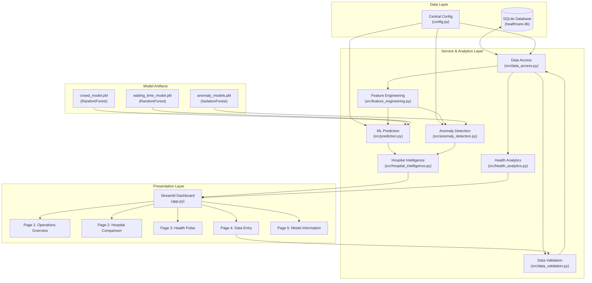

# Connected Healthcare — System Architecture Document

## 1. High-Level Architecture Overview

Connected Healthcare is designed around a modular, decoupled architecture ensuring separation of concerns between data storage, feature engineering, machine learning pipelines, rule-based heuristics, and user interface rendering:

---

## 2. Component Responsibilities

### A. Configuration Layer (`config.py`)
- Provides deterministic, absolute path resolution using Python's `pathlib.Path`.
- Prevents runtime path-dependency bugs caused by launching Streamlit from different working directories.
- Centralizes demo thresholds (`CROWD_DEVIATION_THRESHOLD = 10`, `WAITING_TIME_THRESHOLD = 80 min`, etc.) and model metadata.

### B. Data Access & Persistence Layer (`src/data_access.py`)
- Encapsulates all interactions with the SQLite relational store (`healthcare.db`).
- Manages connection lifecycle with thread safety and timeouts.
- Enforces parameterized queries (`?` parameter binding) to eliminate SQL injection vulnerabilities.
- Handles atomic write transactions for observation ingestion.

### C. Validation & Sanity Layer (`src/data_validation.py`)
- Enforces data integrity constraints prior to database insertion.
- Rejects negative patient counts, negative waiting minutes, or out-of-bound inputs.
- Validates that foreign key hospital IDs map to existing records.

### D. Feature Engineering Pipeline (`src/feature_engineering.py`)
- Formulates chronological lag features (`shift(1)`), past moving averages (`rolling(3)`), and cyclic time features.
- Strictly prevents lookahead target leakage by omitting future data points from inference features.
- Provides dual-mode execution (`is_training=True` constructs targets; `is_training=False` prepares inference rows).

### E. Machine Learning Inference Engine (`src/prediction.py`)
- Loads and caches serialized Scikit-Learn pipelines (`RandomForestRegressor` and `ColumnTransformer`).
- Guarantees feature alignment (identical feature names, types, and sequence as seen in training).
- Applies physical sanity constraints (e.g., non-negative integer rounding for forecasted patient counts).

### F. Anomaly Detection & Operational Diagnosis (`src/anomaly_detection.py`)
- Employs pre-trained hospital-specific `IsolationForest` models to detect multi-variable outliers.
- Evaluates rule heuristics against operational thresholds to produce transparent, human-readable explanations ("Why was this status assigned?").

### G. Unified Intelligence Aggregator (`src/hospital_intelligence.py`)
- Combines observed metrics, Random Forest predictions, Isolation Forest anomaly scores, and rule-based status into a unified response dictionary for UI consumption.

### H. Public Health Analytics (`src/health_analytics.py`)
- Aggregates daily health-condition case counts across monitored geographic districts.
- Distinguishes absolute differences (+X cases) from percentage changes (+Y%) against a 7-day moving baseline.
- Generates cross-signal context relating hospital pressure to community disease reports without implying clinical causation.

### I. Presentation Layer (`app.py`)
- Built using Streamlit and Plotly for responsive, uncluttered data visualization.
- Organized into 5 distinct modules accessible via sidebar navigation.
- Prominently displays synthetic demo notices and operational disclaimers.

---

## 3. Data Flow Traces

### Trace 1: Operational Monitoring & Prediction Flow
1. User selects a hospital on **Page 1**.
2. `src/data_access.py` retrieves historical observations for that hospital from `healthcare.db`.
3. `src/feature_engineering.py` constructs historical lag and rolling features for the latest observation.
4. `src/prediction.py` loads the pre-trained `crowd_model.pkl` and `waiting_time_model.pkl` from memory cache and predicts $t+1$ values.
5. `src/anomaly_detection.py` scores the observation with `IsolationForest` and evaluates heuristic indicators.
6. `src/hospital_intelligence.py` merges all outputs into a structured intelligence payload.
7. `app.py` renders the 4 situation cards, status alert banner, prediction delta cards, and Plotly historical trend chart.

### Trace 2: Data Entry & Storage Flow
1. User submits an observation via the form on **Page 4**.
2. `src/data_validation.py` verifies all fields (non-negativity, valid hospital ID, bounded integers).
3. `src/data_access.py` executes a parameterized `INSERT` query inside an atomic transaction.
4. Database assigns an autoincrement ID and commits.
5. Immediate UI feedback renders the new record ID and timestamp.

---

## 4. Reliability & Edge Case Handling

| Potential Failure Mode | Architectural Mitigation |
| :--- | :--- |
| **Streamlit run from different directory** | Absolute path resolution in `config.py` using `Path(__file__).resolve().parent`. |
| **Single observation / Cold start** | `src/feature_engineering.py` fills initial lags gracefully (`fillna`) with current crowd rather than crashing. |
| **Negative user inputs** | `src/data_validation.py` raises `ValidationError` with user-friendly error message before reaching SQL. |
| **Missing target at forecast time** | Lookahead target `shift(-1)` is restricted strictly to training; inference pipeline only consumes current and lagged features. |
| **Model reloading latency** | `src/prediction.py` and `src/anomaly_detection.py` cache loaded models in memory, eliminating redundant disk reads on dashboard interactions. |
